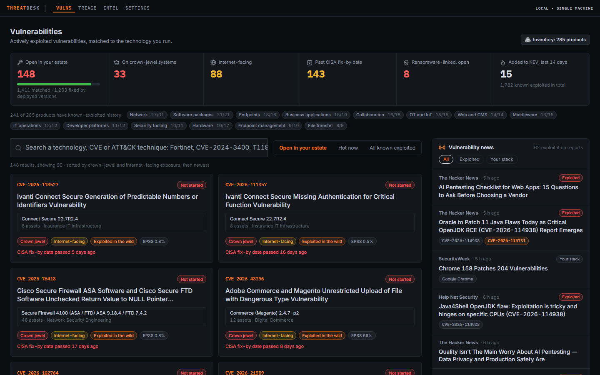
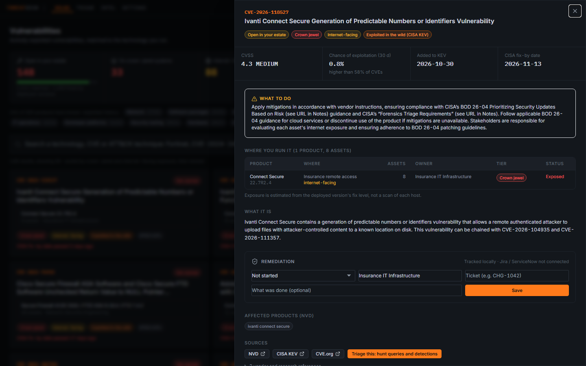
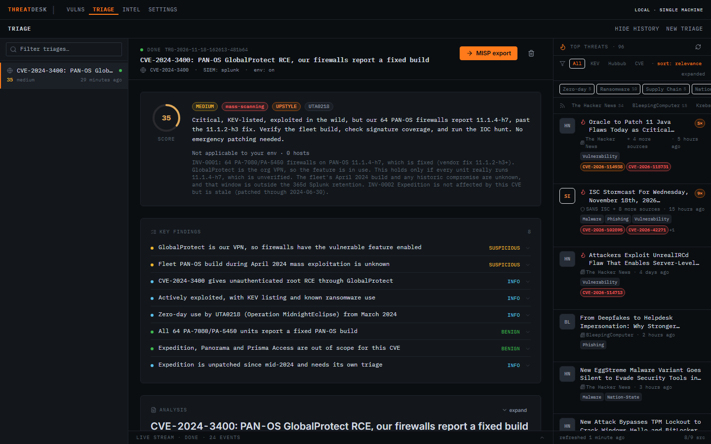
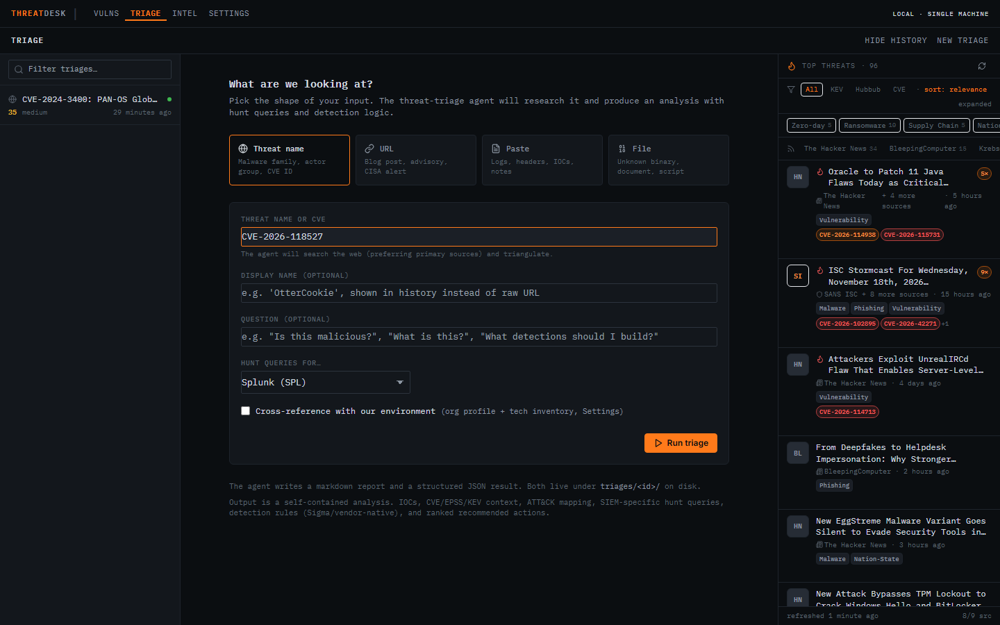
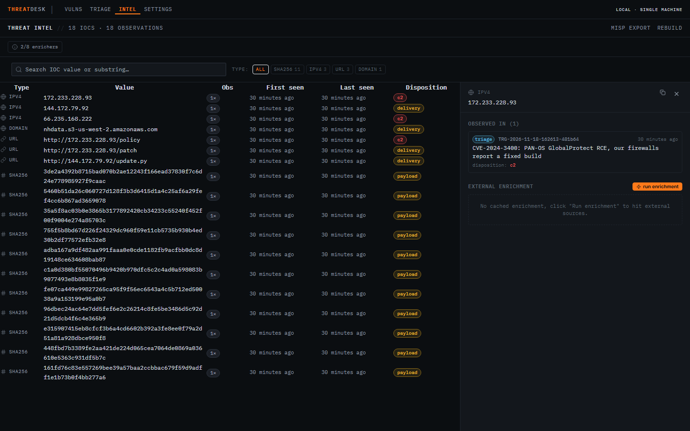
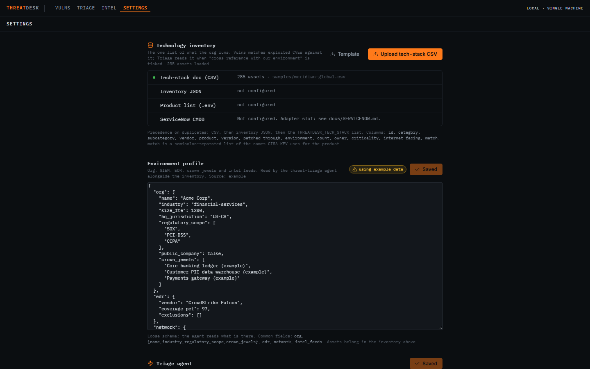
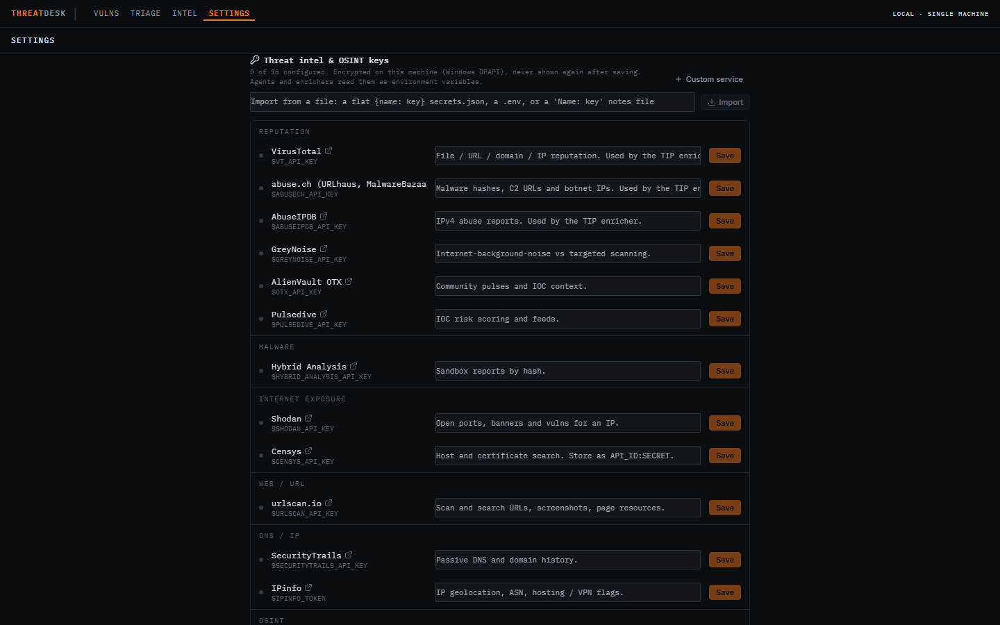
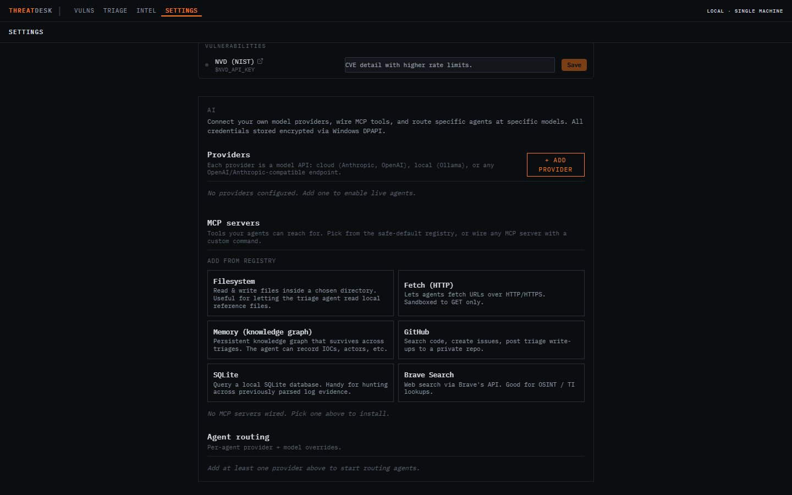

# ThreatDesk

Agent-driven threat triage and an exploited-vulnerability dashboard, matched to your technology inventory. It runs on a single machine.

ThreatDesk was carved out of SOC-in-a-Box (2026-11-18). It contains SOC-in-a-Box's Threat Triage, Vulnerabilities, Threat Feed and Intel (TIP) capabilities. There are no incidents, no CSIRT agents and no endpoint tooling. Nothing imports from or calls SOC-in-a-Box, and `tests/test_isolation.py` enforces this.

**Contents:** [What each section is for](#what-each-section-is-for) · [Install on a demo machine](#install-on-a-demo-machine-windows-1011) · [Connecting API keys and agentic services](#connecting-api-keys-and-agentic-services) · [Telling it what you run](#telling-it-what-you-run) · [Before production](#before-production-known-demo-shortcuts)

## What each section is for

ThreatDesk has four tabs. All screenshots below use the bundled synthetic inventory ("Meridian Global", a fictional Fortune-50 group).

### Vulns: which exploited vulnerabilities hit our stack



**Purpose:** the vulnerability dashboard for leadership and vuln-management teams. ThreatDesk matches the CISA Known Exploited Vulnerabilities catalog against the org's technology inventory. The headline tiles answer:

- What is open in our estate?
- How much of it is on crown-jewel systems?
- How much is internet-facing?
- What is past CISA's fix-by date?
- What is ransomware-linked?
- What did KEV add in the last 14 days?

The filters switch between **Open in your estate**, **Hot now** and **All known exploited**. Search accepts a product, a CVE id or an ATT&CK technique. The right rail is vulnerability news tagged *Exploited* or *Your stack*. A version that already includes the fix (`patched_through` in the inventory) is shown as covered, not as open exposure.



**CVE detail:** click any card to open the drawer:

- CVSS, EPSS exploit probability, the KEV dates and CISA's required action.
- **Where you run it**: products, asset counts, owner, tier and exposure.
- The NVD description and sources.
- A **Remediation** record: status, owner, ticket number, notes, with history kept in `config/vuln_tracking.json`.

**Triage this** hands the CVE straight to the triage agent.

### Triage: agentic threat analysis



**Purpose:** the threat-ops triage workbench. Give it a threat and the `threat-triage` agent (Claude, via Claude Code) researches it, cross-references our environment, and streams back an analyst-grade answer to *what is this, does it matter to us, and what do we do?* The answer includes:

- a score and severity
- an exposure verdict citing the matching inventory rows
- dispositioned key findings
- runnable SIEM hunt queries (Splunk, XSIAM, Elastic, Sentinel, Chronicle, KQL)
- detection rules
- ranked actions
- IOCs

**MISP export** downloads the triage as a MISP Event. The right rail is a live, de-duplicated feed of top threats (CISA, KEV, The Hacker News, BleepingComputer, Krebs, SANS ISC, and others). Any item triages in one click.



**Starting a triage:**

1. Pick the input shape: threat name or CVE, URL, pasted text (logs, headers, IOCs), or a file. Uploaded files are SHA-256 hashed on intake.
2. Pick the SIEM the hunt queries should target.
3. Optionally tick **Cross-reference with our environment**. The agent then reads the org profile and inventory.

Each triage is kept on disk under `triages/<id>/`: input, report, structured result and an append-only event log.

### Intel: the indicator catalog



**Purpose:** a lightweight local threat-intelligence platform. Every IOC from every triage (IPs, domains, URLs, hashes, emails) lands here, de-duplicated, with where it was seen and its disposition (c2, delivery, payload). **Run enrichment** queries the configured enrichers on demand: URLhaus, ThreatFox, MalwareBazaar, Feodo Tracker, Shodan InternetDB, CIRCL hashlookup, VirusTotal and AbuseIPDB. Results are cached for 24 h. **MISP export** produces one MISP Event per triage for import into a real MISP.

### Settings: inventory, environment, agent, keys, AI



**Purpose:** tells ThreatDesk what the org runs and how the agent should work.

- **Technology inventory.** Upload the tech-stack CSV; **Template** downloads a blank one. The sources list shows what is loaded (CSV, inventory JSON, `.env` product list, and the ServiceNow CMDB slot).
- **Environment profile.** The org profile the agent reads during "cross-reference" triage: org, regulatory scope, crown jewels, EDR, network, sensors and intel feeds.
- **Triage agent.** Model choice, subscription vs API-key billing, and an optional refusal fallback.





The bottom half holds the **threat-intel & OSINT keys** and the **AI** panel (providers, MCP servers, agent routing). See [Connecting API keys and agentic services](#connecting-api-keys-and-agentic-services).

## Install on a demo machine (Windows 10/11)

**1. Get the code.** The repo is private, so sign in to GitHub on that machine first. Use either option:

- **With git:** run `gh auth login` (or sign in through Git for Windows), then:
  ```powershell
  git clone https://github.com/jaxdeformity/ThreatDesk.git
  cd ThreatDesk
  ```
- **Without git:** on github.com/jaxdeformity/ThreatDesk, use **Code → Download ZIP**, extract it, and open a terminal in the folder.

**2. Install.**

```powershell
.\install.cmd -Demo -InstallPrereqs
```

- `-Demo` loads the bundled synthetic Fortune-50 inventory, so the Vulns tab is full on first launch.
- `-InstallPrereqs` uses winget to install anything missing: Python 3.12, jq, Node LTS and the Claude Code CLI. Leave it off if those are already installed.

The installer creates `.venv`, installs ThreatDesk, writes `.env`, and adds `Start-ThreatDesk.cmd` plus a **ThreatDesk** desktop shortcut. It then opens http://127.0.0.1:8444.

The UI ships prebuilt in `web-dist/`, so the demo machine does not need Node unless you rebuild the UI.

**3. Sign the triage agent in (once).** Either option works:
- Run `claude` in a terminal and log in with a Claude account.
- Paste an Anthropic API key into **Settings → AI providers**.

Vulns, Intel and the threat feed work without this. Only Triage needs it.

**4. Demo.** Start it any time from the desktop shortcut. To update the demo machine later, run `git pull`, then `.\install.cmd -NoLaunch`.

| Option | Effect |
|---|---|
| `-Demo` | Inventory = `samples/meridian-global.csv` |
| `-InstallPrereqs` | winget/npm install of missing prerequisites |
| `-Port 9000` | Serve on another port (default 8444) |
| `-NoLaunch` | Install only |
| `-NoShortcut` | No desktop shortcut |

Network needs: outbound HTTPS to CISA, FIRST (EPSS), NIST NVD, the news RSS feeds, and Anthropic (for triage). Behind a proxy, set `HTTPS_PROXY` before installing and launching.

### Prerequisites the installer checks

- Python 3.11+
- [Claude Code CLI](https://docs.claude.com/claude-code) (`npm i -g @anthropic-ai/claude-code`). The triage agent runs through it.
- `jq` (`winget install jqlang.jq`) and `curl` (ships with Windows). The agent uses both.
- Node 20+ only if you rebuild the UI.

## Developer setup

```powershell
python -m pip install -e .[test]
cd web; npm install; npm run build; cd ..   # rebuild web-dist/ and commit it after UI changes
copy .env.example .env
threatdesk --open                           # http://127.0.0.1:8444
```

The port is `THREATDESK_PORT`, default 8444, so it runs alongside SOC-in-a-Box on 8443. For hot reload, run `threatdesk --reload` in one shell and `cd web; npm run dev` in another. Vite serves on :5173 and proxies `/api` to :8444.

## Connecting API keys and agentic services

ThreatDesk's intent is an **agentified threat-triage process** that knows the enterprise's environment, plus a **vulnerability dashboard** driven by the enterprise's real inventory. Everything below is configured in **Settings**. Keys are encrypted at rest with Windows DPAPI (per Windows user) and never shown again after saving. Nothing goes in git.

### 1. The triage agent's model access (required for Triage)

The agent is Claude, run through the Claude Code CLI. Pick one of these:

| Option | How | Billing |
|---|---|---|
| **Anthropic API key** (recommended for enterprise) | Settings → AI → **Providers → + Add provider** → kind `anthropic`, paste the key, Save (it validates the key). Or set `ANTHROPIC_API_KEY` in the Windows environment before launching. | The enterprise's Anthropic account |
| **Claude login** (quick demo) | Run `claude` once in a terminal and sign in. Then turn on Settings → Triage agent → **Run on the logged-in Claude subscription** (needed only if an API key is also set). | That Claude account's plan |
| **Amazon Bedrock / Google Vertex AI** | Set the Claude Code env vars in the Windows environment before launching. Bedrock: `CLAUDE_CODE_USE_BEDROCK=1` plus AWS credentials/region. Vertex: `CLAUDE_CODE_USE_VERTEX=1` plus `CLOUD_ML_REGION`, `ANTHROPIC_VERTEX_PROJECT_ID`. Then pick a model id your cloud exposes. | The enterprise's cloud account |

The model is set under Settings → **Triage agent**; the default is Claude Opus 5.5. **Agent routing** can pin the `threat-triage` agent to a provider and model. Route only to Claude models: the agent runs through Claude Code.

### 2. Threat-intel and OSINT keys (optional; enrich Intel and Triage)

Settings → **Threat intel & OSINT keys.** Paste a key and Save, or **Import** from a `.env`, a flat `{name: key}` JSON, or a `Name: key` notes file. **+ Custom service** adds any other API key under an env-var name you choose. Saved keys are exposed to the enrichers and to the triage agent as environment variables.

| Service | Env var | Used for |
|---|---|---|
| VirusTotal | `VT_API_KEY` | File/URL/domain/IP reputation (Intel enrichment, agent lookups) |
| abuse.ch | `ABUSECH_API_KEY` | URLhaus, ThreatFox, MalwareBazaar enrichment |
| AbuseIPDB | `ABUSEIPDB_API_KEY` | IP abuse reports |
| GreyNoise, AlienVault OTX, Pulsedive | `GREYNOISE_API_KEY`, `OTX_API_KEY`, `PULSEDIVE_API_KEY` | Noise vs targeted, community pulses, risk scoring |
| Hybrid Analysis | `HYBRID_ANALYSIS_API_KEY` | Sandbox reports by hash |
| Shodan, Censys | `SHODAN_API_KEY`, `CENSYS_API_KEY` | Internet exposure of IPs/hosts |
| urlscan.io, SecurityTrails, IPinfo | `URLSCAN_API_KEY`, `SECURITYTRAILS_API_KEY`, `IPINFO_TOKEN` | URL scans, passive DNS, IP context |
| HIBP, WiGLE, GitHub | `HIBP_API_KEY`, `WIGLE_API_KEY`, `GITHUB_TOKEN` | OSINT |
| NVD | `NVD_API_KEY` | Higher NVD rate limits for the Vulns tab |

These need no key: Shodan InternetDB and CIRCL hashlookup. CISA KEV, FIRST EPSS and NVD work keyless at lower rate limits.

### 3. Agentic tools via MCP (connect the agent to enterprise systems)

This is how the triage agent reaches enterprise systems: ServiceNow, the SIEM, the EDR, a ticketing system, internal wikis. Go to Settings → AI → **MCP servers**:

- **Add from registry:** one-click Filesystem, Fetch, Memory, GitHub, SQLite and Brave Search.
- **Custom:** any MCP server. Give it an id, a command (e.g. `npx`, `uvx`, `python`), its args, and env values. Mark tokens and passwords as **secret**.

Every enabled server is attached to each triage run. The agent's tools then include the server's tools, and `triages/<id>/mcp-config.json` records which servers were attached. Secret values are not written there: they're passed to the server through the agent's process environment (verified: MCP servers launched by the agent inherit it).

**Example: ServiceNow.** Add a custom MCP server pointing at a ServiceNow MCP implementation (community or your own). Give it env `SERVICENOW_INSTANCE` (plain) and `SERVICENOW_USERNAME` / `SERVICENOW_PASSWORD` or an OAuth token (secret). Then add one line to `.claude/agents/threat-triage.md` under step 5 telling the agent when to use it. For example: *"If a ServiceNow MCP tool is available, look up affected CIs and open incidents for the products in `our_exposure`."*

The vulnerability side's ServiceNow integration is separate. A CMDB → inventory adapter and a remediation → ticket sync plug into the seams described in [docs/SERVICENOW.md](docs/SERVICENOW.md) (not built in v1).

### 4. The environment the agent reasons about

- **Inventory:** upload the tech-stack CSV (see [Telling it what you run](#telling-it-what-you-run)).
- **Environment profile:** edit the JSON in Settings with the real org name, regulatory scope, crown jewels, EDR, SIEM, network and intel feeds. Until you save it, the agent is told it's looking at stock example data.

## Telling it what you run

Vulns matching and triage's "cross-reference with our environment" both read one inventory (`threatdesk/inventory.py`). These sources are listed in precedence order:

1. **Tech-stack CSV.** One uploaded in Settings (stored at `config/tech-stack.csv`, which then wins), else the file named by `THREATDESK_TECH_STACK_CSV`. Start from `config/tech-stack.template.csv`. See [docs/TECH-STACK.md](docs/TECH-STACK.md).
2. **Inventory JSON** (`THREATDESK_INVENTORY`), `{"assets": [...]}`.
3. **Product list:** `THREATDESK_TECH_STACK="Microsoft Exchange, Fortinet FortiOS"`.
4. **ServiceNow CMDB.** The slot exists but there's no adapter yet. See [docs/SERVICENOW.md](docs/SERVICENOW.md).

A synthetic Fortune-50 inventory ("Meridian Global", fictional, 285 products) ships in `samples/` for demos. The installer's `-Demo` switch points at it (`THREATDESK_TECH_STACK_CSV=samples/meridian-global.csv`).

## Data on disk (all gitignored)

| Path | What |
|---|---|
| `triages/<TRG-id>/` | `input.json` (with SHA-256 of every attachment), `attachments/`, `events.jsonl` (append-only stream), `report.md`, `result.json`, `status.json`, `mcp-config.json` (MCP servers attached, no secrets) |
| `config/vuln_tracking.json` | Remediation status, owner, ticket, notes, history per CVE. Each record carries `provider` / `external_ref` for a future ServiceNow sync. |
| `config/cache/` | KEV / EPSS / NVD / news cache |
| `tip/enrichment/` | IOC enrichment cache (24 h) |
| `config/environment.json`, `config/runtime-settings.json`, `config/ai_config.json`, `config/service_keys.json` | Settings |
| `logs/` | Per-triage debug logs |

Outbound requests send only CVE ids, IOC values and search words. Inventory matching happens locally. The triage agent is told never to put org names, hostnames or asset details into web searches. When "cross-reference with our environment" is ticked, the inventory is sent to the model provider as context.

## Before production (known demo shortcuts)

- The agent runs Claude Code with `--dangerously-skip-permissions`. Replace it with an explicit allowed-tools list (WebFetch, WebSearch, Read/Write under `triages/<id>/`, Bash for `curl` / `jq` / `sha256sum`). Enterprise-managed Claude Code settings may disable bypass mode, and then every triage fails at launch.
- There's no auth, and it's single-user by design. It binds to `127.0.0.1` only.
- The Windows DPAPI key store makes it Windows-only.

## Tests

```powershell
python -m pytest -q          # backend + isolation guard
cd web; npm test; npm run build
```

See [docs/DEPENDENCIES.md](docs/DEPENDENCIES.md) for every SOC-in-a-Box coupling and what replaced it, and [docs/PARITY.md](docs/PARITY.md) for the parity check against SOC-in-a-Box.
